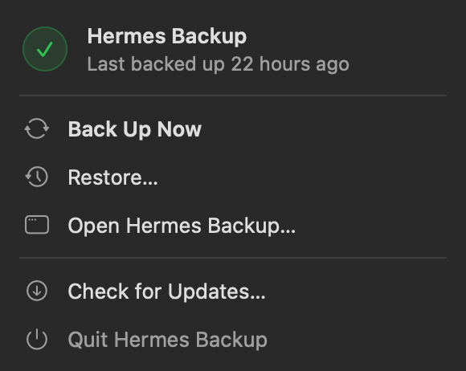
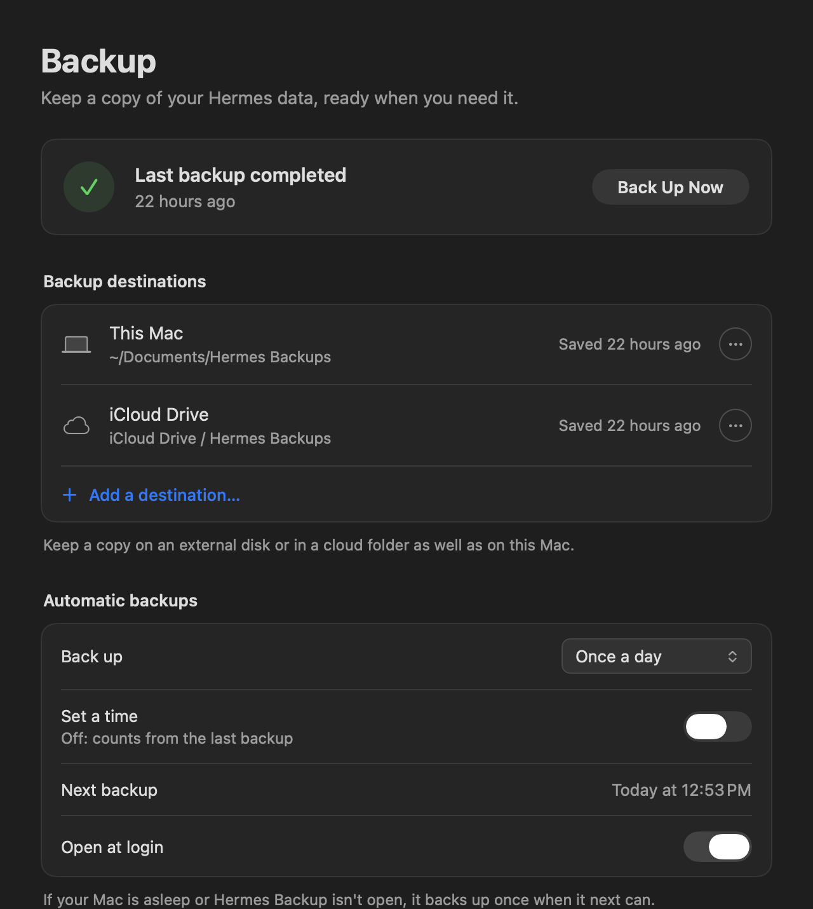
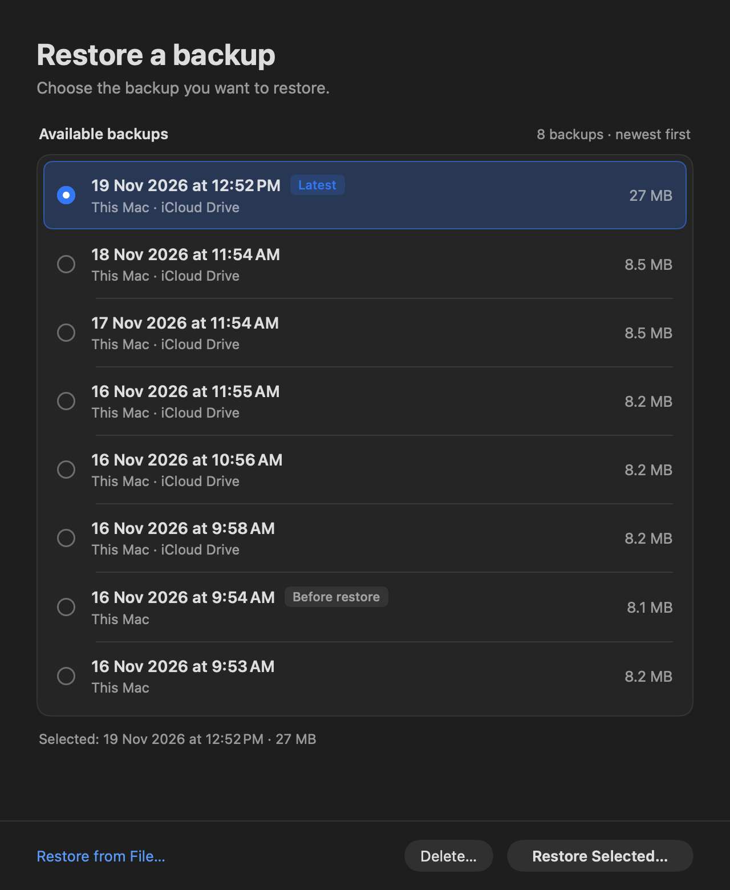

# Hermes Backup

A small Mac menu-bar app that keeps encrypted backups of your [Hermes Agent](https://github.com/NousResearch/hermes-agent) and restores them with one click.

Hermes keeps everything that makes it *yours* (memories, skills, chat sessions, scheduled jobs, settings, API keys and logins) in `~/.hermes`. If your Mac dies, gets wiped, or an update goes wrong, that's gone. Hermes Backup copies it on a schedule to this Mac, an external disk and/or a cloud folder, so you can get it all back.

  

  
  &nbsp;
  

## What it does

- **Backs up automatically.** Every hour, every 4 hours, twice a day or once a day. You can also pick exact times. If your Mac was asleep, it catches up once when it wakes. It also backs up when you plug in your backup disk.
- **Saves to several places.** This Mac, an external disk, or any synced cloud folder (iCloud Drive, Dropbox, Google Drive, OneDrive). The cloud app does the uploading.
- **Encrypts every backup.** Each one is an AES-256 encrypted disk image locked with a password you choose (it holds your API keys and tokens). The password is kept in your Mac's Keychain.
- **Restores with one click.** Pick a backup and click Restore. It saves your current Hermes as a "before restore" copy first, stops Hermes safely, puts the backup back and reopens Hermes. A wrong password changes nothing.
- **Cleans up after itself.** Old backups thin out automatically (newest 24, then daily for 2 weeks, weekly for 2 months, monthly for a year), so it won't fill your disk. You can also delete any backup yourself.
- **Works without the app, too.** A backup is a normal `.dmg`: double-click it, type the password, and follow `How to restore.txt` inside.

## Install

1. Download the `.dmg` from the [latest release](https://github.com/Latrixz/hermes-backup/releases/latest). It's signed and notarized by Apple, so it opens without warnings.
2. Drag **Hermes Backup** to Applications and open it. It lives in the menu bar.
3. Choose a backup password, add any extra destinations, and you're done.

**Needs:** macOS 14 or later, and [Hermes Agent](https://github.com/NousResearch/hermes-agent) installed (the `hermes` command).

> **Keep your password safe.** Without it, a backup can't be opened, by design.

### Updates

Hermes Backup checks this repo's releases once a day. When there's a new version, the menu shows **Update to x.y.z…**; click it to see what's new, then **Install and Relaunch**. You can also choose **Check for Updates…** at any time. Before installing, it checks the download is signed by the same developer and is the version it claims to be. Your settings, password and backups aren't touched.

## How it works

- **Backup** runs Hermes' own `hermes backup` (a WAL-safe, integrity-checked SQLite snapshot that skips the codebase), adds the desktop app's chat images from `~/Library/Application Support/Hermes`, and seals it all in an encrypted disk image. Usually 10–30 MB and about 10 seconds.
- **Destinations** are plain folders. Copies go into a `Hermes Backups` folder, written under a hidden name and renamed only once complete, so a half-written backup never looks real.
- **Restore** unlocks first, saves the current Hermes as a "before restore" backup, quits the Hermes desktop app, stops the gateway, refuses if Hermes is still running elsewhere, runs `hermes import --force`, copies back the desktop extras, and reopens Hermes.

## Build from source

    ./build.sh --local --install      # quick build for this Mac, installs to /Applications
    ./build.sh --dmg                  # universal build + DMG, ad-hoc signed
    SIGN_IDENTITY="Developer ID Application: …" NOTARY_PROFILE=<profile> ./build.sh --dmg   # signed + notarized

Run tests with `swift test`.

To publish a release (tests, version bump, signed and notarized DMG, tag, GitHub release):

    scripts/release.sh 0.2.0 "What changed"
 Icon: `swift scripts/make-icon.swift && iconutil -c icns build/AppIcon.iconset -o Resources/AppIcon.icns`

### Testing without touching your live Hermes

    .build/debug/HermesBackup --test-backup <folder> <password>
    .build/debug/HermesBackup --test-unlock <dmg> <password> <outdir>
    HERMES_HOME=<sandbox> hermes import --force <outdir>/hermes-backup.zip

Settings live in `~/Library/Application Support/HermesBackup/settings.json`.

## License

[MIT](LICENSE). Hermes Backup is an independent tool and isn't made by Nous Research.
